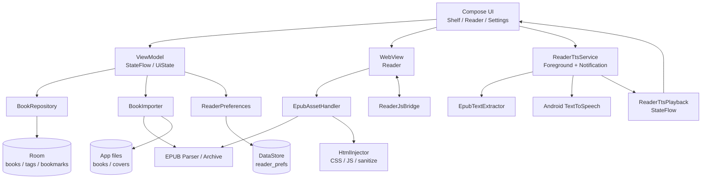
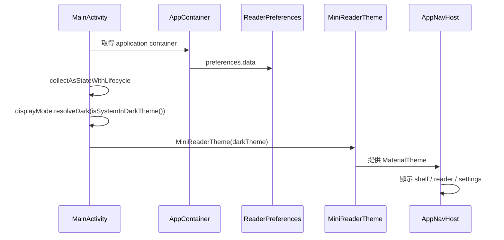
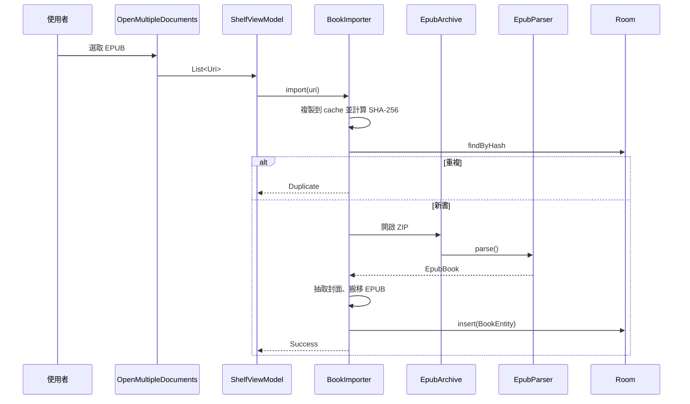
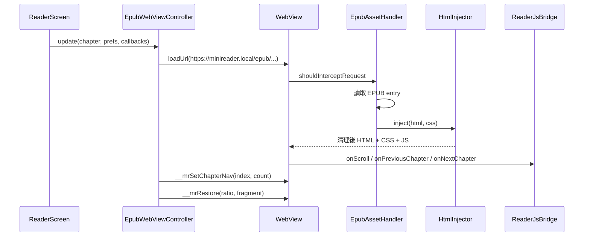

# 系統架構與技術文件

本文件說明 mini閱讀器的技術架構、主要元件、資料流與實作細節，適合開發者與維護者閱讀。

## 1. 技術概觀

| 項目 | 內容 |
| --- | --- |
| 語言 | Kotlin 2.1.0 |
| UI | Jetpack Compose、Material 3 |
| 導覽 | Navigation Compose |
| 本機資料庫 | Room 2.6.1 + KSP |
| 偏好設定 | DataStore Preferences |
| 閱讀引擎 | Android WebView + WebViewAssetLoader |
| 朗讀 | Android TextToSpeech + 前景服務 |
| 圖片載入 | Coil |
| 非同步 | Kotlin Coroutines / Flow |
| 建置 | Gradle 8.11.1、AGP 8.9.2、JDK 17 |
| 最低版本 | Android 8.0（API 26） |
| 目標版本 | Android 15（API 35） |

## 2. 分層架構



### UI 層

- `ui/shelf`：書架、搜尋、排序、標籤管理、書本詳細資訊。
- `ui/reader`：閱讀器、目錄、書籤、排版設定、朗讀控制、WebView 控制。
- `ui/settings`：全域閱讀設定。
- `ui/theme`：Material 3 色彩配置，依護眼模式與顯示模式產生。
- `ui/system`：系統狀態列／導覽列顏色與圖示明暗。

### ViewModel 層

- `ShelfViewModel`：書架資料、搜尋、排序、標籤、匯入狀態、書本詳細資訊。
- `ReaderViewModel`：章節、目錄、閱讀進度、書籤、偏好設定。
- `SettingsViewModel`：閱讀設定讀寫。

畫面狀態以 `StateFlow` / `UiState` 表示，UI 透過 `collectAsStateWithLifecycle()` 訂閱。

### 資料層

- `BookRepository`：書籍、標籤、書籤與進度存取。
- `BookImporter`：匯入 EPUB、計算 SHA-256、解析中繼資料、抽取封面、寫入檔案與資料庫。
- `ReaderPreferences`：DataStore 偏好設定與版本相容轉換。
- `data/epub`：EPUB ZIP 存取、XML 解析、目錄解析、字數統計。
- `data/tts`：朗讀文字抽取、播放狀態、前景服務與通知控制。
- `AppDatabase`：Room 資料庫。

## 3. 應用程式啟動流程



`AppContainer` 以手動依賴注入建立：

- `AppDatabase`
- `ReaderPreferences`
- `BookRepository`
- `BookImporter`

## 4. 資料模型

Room 資料庫名稱：`minireader.db`，目前版本 `1`，`exportSchema = true`，schema 位於 `app/schemas/`。

### `books`

| 欄位 | 說明 |
| --- | --- |
| `id` | UUID |
| `displayTitle` | 顯示書名（可重新命名） |
| `originalTitle` | EPUB 原始書名 |
| `author` | 作者，可能為 null |
| `coverPath` | 封面 JPEG 路徑 |
| `filePath` | EPUB 本機路徑 |
| `fileHash` | SHA-256，唯一索引 |
| `fileSize` | 檔案大小 |
| `addedAt` | 加入時間 |
| `lastOpenedAt` | 最近開啟時間 |
| `progressHref` | 上次閱讀章節 |
| `progressRatio` | 章節內捲動比例 |
| `progressFraction` | 全書進度 |
| `updatedAt` | 更新時間 |

### `tags`

| 欄位 | 說明 |
| --- | --- |
| `id` | UUID |
| `name` | 唯一名稱 |
| `color` | ARGB 顏色（Long） |

### `book_tags`

書籍與標籤的多對多關聯，使用外鍵 CASCADE 刪除。

### `bookmarks`

| 欄位 | 說明 |
| --- | --- |
| `id` | UUID |
| `bookId` | 所屬書籍 |
| `chapterHref` | 章節路徑 |
| `chapterTitle` | 章節標題 |
| `scrollRatio` | 章節內位置 |
| `excerpt` | 書籤文字 |
| `note` | 備註 |
| `createdAt` | 加入時間 |

## 5. EPUB 匯入與解析

### 匯入流程



### EpubParser

自製的輕量 EPUB 2/3 解析器，不依賴第三方 EPUB 函式庫：

- 讀取 `META-INF/container.xml` 取得 OPF。
- 解析 OPF 的 title、creator、language、manifest、spine。
- 優先解析 EPUB3 navigation document，找不到時改用 NCX。
- 建立章節與目錄的對應關係。
- 偵測 `META-INF/rights.xml` 並拒絕 DRM 書籍。

### 封面處理

- 依 OPF `meta name="cover"`、`properties="cover-image"` 或第一張圖片尋找封面。
- 使用 `BitmapFactory` 解碼，必要時降低取樣，輸出 JPEG（品質 86）到 `filesDir/covers/`。

### 字數統計

`EpubTextStats` 會讀取各章 HTML：

- 移除註解、script、style、HTML 標籤與實體。
- CJK 字元逐字計數。
- 連續拉丁字母或數字算作一個字。
- 僅在開啟書本詳細資訊時計算，避免匯入時增加等待時間。

## 6. 閱讀器架構

### WebView 載入流程



### 主要元件

- `EpubWebViewController`：管理 WebView、載入章節、套用樣式、還原位置。
- `ReaderWebView`：Compose `AndroidView` 包裝。
- `EpubAssetHandler`：透過 `WebViewAssetLoader` 提供 EPUB 內資源。
- `HtmlInjector`：注入 CSS/JS，並移除不安全內容。
- `HtmlDecoder`（`data/epub`）：處理 HTML 編碼。
- `ReaderStyle`：產生閱讀 CSS 與 JavaScript。
- `ReaderJsBridge`：JavaScript 與 Kotlin 的橋接。

### JavaScript Bridge

WebView 以 `Android` 名稱注入 `ReaderJsBridge`，提供：

- `onScroll(ratio)`：回報章節內捲動比例。
- `onPreviousChapter()`：上一章。
- `onNextChapter()`：下一章。

另外提供 `window.__mrScrollToRatio(ratio)` 供朗讀時將畫面捲到目前句子的大致位置。

建構參數使用 `scrollHandler`、`tapHandler`、`previousChapterHandler`、`nextChapterHandler` 命名，避免與 `@JavascriptInterface` 方法同名造成遞迴。

### 章節底部導覽

`ReaderStyle.javascript()` 提供 `window.__mrSetChapterNav(chapterIndex, chapterCount)`：

- 在 `body` 末尾建立 `.mr-chapter-nav`。
- 首章停用上一章，末章停用下一章。
- 單章書籍隱藏導覽。
- 按鈕點擊透過 JS Bridge 通知 Android。

### 滑動切換章節

- 監聽 `touchstart` / `touchend` / `touchcancel`。
- 水平位移需達 `max(56px, min(140px, window.innerWidth * 20%))`。
- 或快速輕甩：水平位移至少 8% 螢幕寬，且速度達 0.6 px/ms。
- 水平位移需大於垂直位移的 1.5 倍。
- 向左滑呼叫 `onNextChapter()`，向右滑呼叫 `onPreviousChapter()`。

### 閱讀進度

- `progressFraction = (chapterIndex + scrollRatio) / chapterCount`。
- 捲動時最多每 700ms 更新 UI，並延遲 900ms 寫入資料庫。
- 離開頁面或 App 進入背景時立即保存。
- 開啟書籍時依 `progressHref` + `progressRatio` 還原。

### 朗讀（TTS）

朗讀由 `data/tts` 與 `ReaderScreen` 協作：

- `EpubTextExtractor`：從目前章節 HTML 取出純文字，移除 script、style、nav、ruby 注音等內容，依中英文標點切句，再合併為約 200 字元的段落。輸出保留字元位移，供比例換算。
- `ReaderTtsService`：前景服務，持有 `TextToSpeech` 引擎，逐段朗讀目前章節。支援暫停（保留目前段落索引）、續播、停止與語速調整。
- `ReaderTtsPlayback`：全域 `StateFlow` 播放狀態，讓 UI 與服務共用狀態，離開閱讀頁後仍可取得背景播放進度。
- 朗讀從目前閱讀比例換算起始段落；每段開始時更新比例，閱讀頁透過 `scrollToRatio()` 自動捲動。
- 讀完目前章節後停止，不自動接續下一章。
- 背景播放使用 `mediaPlayback` 前景服務型別、通知控制、音訊焦點與 partial wake lock。
- 服務每約 10 秒回寫閱讀進度，避免背景播放時進度遺失。
- Android 11+ 以 `<queries>` 宣告 `TTS_SERVICE`；Android 13+ 需要通知權限才能顯示背景控制。

## 7. 偏好設定

DataStore 檔名：`reader_prefs`。

| Key | 型別 | 說明 |
| --- | --- | --- |
| `font_size` | Float | 字級 |
| `font_family` | String | 襯線／無襯線／粗體 |
| `line_height` | Float | 行距 |
| `letter_spacing` | Float | 字距 |
| `paragraph_spacing` | Float | 段落間距 |
| `horizontal_margin` | Int | 左右邊距 |
| `text_alignment` | String | 對齊方式 |
| `first_line_indent` | Boolean | 首行縮排 |
| `reader_theme` | String | 淺色模式護眼主題 |
| `reader_dark_theme` | String | 深色模式護眼主題 |
| `display_mode` | String | SYSTEM / LIGHT / DARK |
| `keep_screen_on` | Boolean | 保持螢幕亮起 |
| `shelf_sort` | String | 書架排序 |
| `shelf_layout` | String | 書架顯示方式（GRID / COMPACT） |
| `tts_speed` | Float | 朗讀語速（0.5–2.0） |

### 顯示模式與主題

`DisplayMode.resolveDark(systemDark)` 決定目前是否為深色：

- `SYSTEM`：跟隨系統。
- `LIGHT`：固定淺色。
- `DARK`：固定深色。

`ReaderPrefs.effectiveTheme(systemDark)` 會依目前模式回傳 `theme` 或 `darkTheme`。主介面、閱讀頁與系統列都使用這組生效主題。

舊資料若 `reader_theme` 為深色主題，載入時會自動遷移為 `reader_dark_theme`，並將淺色主題回復為預設米黃。

## 8. 主題與系統列

- `readerColors(theme)` 定義各護眼模式的前景、背景、次要色、強調色與連結色。
- `readerColorScheme(theme)` 將護眼模式轉為 Material 3 `ColorScheme`。
- `SystemBarAppearance` 設定狀態列與導覽列背景，並依背景亮度切換圖示明暗。
- Android 15 以上可能忽略系統列顏色設定，頁面背景會透出；圖示明暗仍會調整。

## 9. 安全設計

### WebView 限制

- `allowFileAccess = false`
- `allowContentAccess = false`
- `mixedContentMode = NEVER_ALLOW`
- 僅允許 `minireader.local` 網域透過 `WebViewAssetLoader` 載入資源。
- 其他 HTTP/HTTPS 連結不會在 WebView 內開啟，而是顯示確認對話框後交給系統瀏覽器。
- 外部 scheme 不會自動開啟。

### HTML 清理

`HtmlInjector` 會移除：

- `<script>` 與自閉合 script
- `<iframe>`、`<object>`、`<embed>`
- `<base>`
- meta refresh 與 CSP meta
- inline event handler（`onclick` 等）
- `javascript:` URL

EPUB 內容被視為不受信任的 HTML。HTML 回應另外加上 Content-Security-Policy，只允許帶 nonce 的閱讀器 script 執行，作為清理規則的第二層防護。

### JavaScript Bridge

僅暴露閱讀所需的最小方法，且所有回呼都切換回主執行緒（`view.post`）再更新 Compose 狀態。

## 10. 建置型別

| Build Type | R8 | 資源縮減 | 簽署 | 用途 |
| --- | --- | --- | --- | --- |
| `debug` | 否 | 否 | Debug | 開發 |
| `release` | 否 | 否 | 未設定 | 預留正式發行 |
| `prerelease` | 是 | 是 | Debug 金鑰 | 測試發行 |

`prerelease` 的 `versionNameSuffix` 為 `-prerelease`，輸出檔名為 `app-prerelease.apk`。

## 11. 測試

目前單元測試包含：

- `EpubParserTest`：EPUB 解析與目錄。
- `EpubArchiveTest`：EPUB entry 大小上限。
- `EpubTextStatsTest`：字數統計。
- `HtmlInjectorTest`：HTML 注入與清理。
- `ReaderJsBridgeTest`：滑動比例邊界與非有限數值。
- `ReaderThemeContrastTest`：各主題 WCAG AA 對比。
- `DisplayModeTest`：顯示模式與主題分流。
- `EpubTextExtractorTest`：朗讀文字清理、切句、分段與比例定位。

執行：

```bash
./gradlew :app:testDebugUnitTest
```

## 12. 已知限制

- 不支援 DRM 保護的 EPUB。
- 不支援 PDF、MOBI、AZW3。
- 沒有雲端同步、跨裝置進度或帳號系統。
- 沒有書內全文搜尋。
- 朗讀僅支援目前章節，且需要裝置具備對應語言的 TTS 引擎與語音資料。
- 朗讀自動捲動以字元比例估算，可能與實際版面位置略有差異。
- 字數為估算值，依 HTML 內容與語言判定。
- Room 目前版本為 1，僅在降級時使用破壞性遷移；未來升級 schema 時必須提供 Migration，否則啟動會失敗以保護書庫資料。
- `release` build type 尚未設定正式簽署資訊。

## 13. 相關文件

- [使用指南](使用指南.md)
- [系統設計文件](系統設計文件.md)
- [開發與建置指南](開發與建置指南.md)
- [發行與版本說明](發行與版本說明.md)
