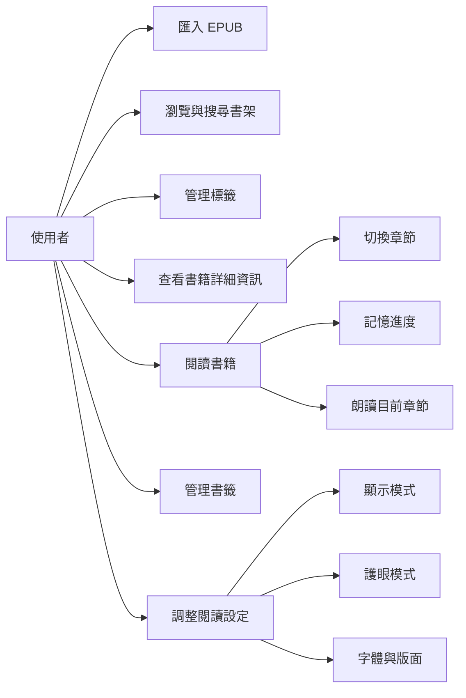
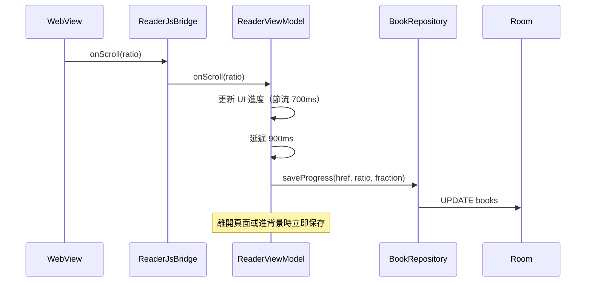
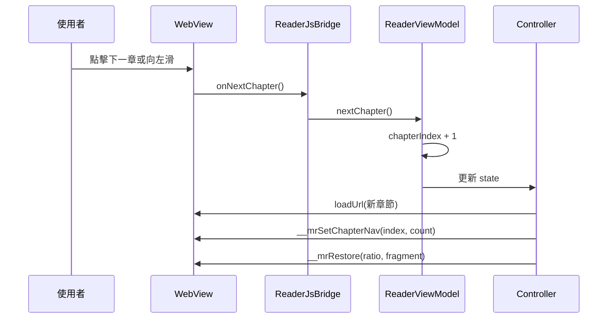
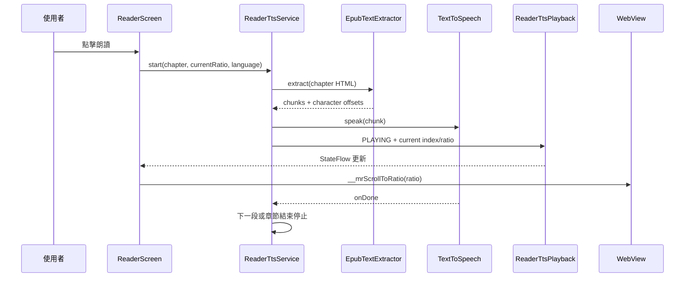
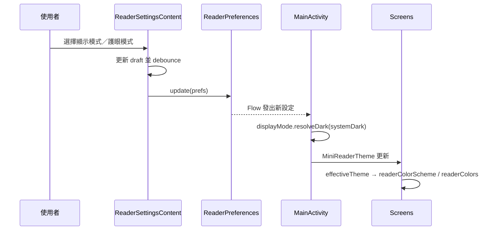

# 系統設計文件

本文件說明 mini閱讀器的產品目標、使用案例、畫面設計、狀態管理與關鍵設計決策。

## 1. 設計目標

1. **離線優先**：不依賴網路或帳號，書籍與閱讀紀錄都在本機。
2. **快速開始**：匯入 EPUB 後立即可讀，不需要設定。
3. **閱讀舒適**：提供多種護眼配色、字體與版面調整。
4. **資料可掌控**：使用者可重新命名、分類、刪除書籍與書籤。
5. **輕量安全**：不執行書籍內的 JavaScript，不載入外部資源。

## 2. 目標使用者

- 想在手機上閱讀無 DRM EPUB 的使用者。
- 偏好離線、無廣告、無帳號的閱讀工具。
- 會自行整理書庫、標籤與書籤的使用者。

## 3. 使用案例



### UC-01 匯入書籍

- 使用者一次選取一或多個 EPUB。
- 系統檢查重複、解析中繼資料、抽取封面、保存檔案。
- 成功後書架更新；失敗時顯示原因。

### UC-02 尋找書籍

- 使用者輸入書名、作者或標籤關鍵字。
- 可依加入時間、最近閱讀、書名、作者或進度排序。
- 可點擊標籤 Chip 進一步篩選。

### UC-03 閱讀與切換章節

- 使用者點擊書籍開啟閱讀器。
- 系統還原上次章節與位置。
- 使用者可透過目錄、底部按鈕或左右滑動切換章節。
- 系統持續保存進度。
- 使用者可從目前位置朗讀目前章節，並在背景繼續播放。

### UC-04 管理書籤

- 使用者在目前位置加入書籤，可編輯內容與備註。
- 書籤頁可查看加入時間、點擊跳轉、刪除。

### UC-05 調整顯示與排版

- 使用者選擇系統／淺色／深色。
- 系統依模式顯示對應的護眼模式清單。
- 使用者調整字體、字級、行距、間距、對齊與縮排。
- 設定即時套用到閱讀頁與主介面。

## 4. 資訊架構

```text
書架（Shelf）
├── 搜尋
├── 排序
├── 顯示方式（封面網格／緊湊清單）
├── 標籤篩選
├── 書籍卡片
│   ├── 點擊 → 閱讀器
│   └── 長按 → 操作選單
│       ├── 詳細資訊
│       ├── 重新命名
│       ├── 設定標籤
│       └── 刪除
└── 更多
    ├── 標籤管理
    └── 閱讀設定

閱讀器（Reader）
├── 頂部工具列（固定顯示）
│   ├── 返回
│   ├── 朗讀
│   ├── 書籤管理
│   └── 更多
│       ├── 目錄
│       └── 排版設定
├── 文章內容
├── 朗讀控制列（播放中顯示）
└── 章節底部導覽

閱讀設定（Settings）
├── 預覽
├── 顯示模式
├── 護眼模式
├── 保持螢幕亮起
├── 字體與版面
└── 對齊與縮排
```

## 5. 畫面設計

### 5.1 書架

- 使用 `LazyVerticalGrid` 自適應欄寬，最小 112dp。
- 封面比例 0.68，圓角 10dp。
- 封面覆蓋：
  - 左上角狀態徽章（未讀／已讀完）。
  - 底部 4dp 進度條。
- 卡片文字：
  - 書名最多 2 行。
  - 作者 1 行。
  - 最近閱讀相對時間。
- 搜尋列預設隱藏，由右上角搜尋圖示切換。
- 右上角另提供顯示方式切換：封面網格或緊湊清單。
- 緊湊清單以單列顯示書名、作者與進度百分比，適合大量書籍。
- 匯入圖示保留在右上角；右下角不設 FAB。

### 5.2 書本詳細資訊

以可捲動對話框呈現，依重要性分組：

1. 書籍資訊：書名、原書名、作者、語言、字數、標籤。
2. 閱讀狀態：狀態、進度、目前章節、最近閱讀、加入時間。
3. 檔案資訊：檔案大小、章節數、書籤數。

語言、字數、章節與書籤數可能需要非同步載入，載入時顯示進度指示。

### 5.3 閱讀器

- 全螢幕 WebView 顯示章節內容。
- 頂部工具列固定顯示於內容上方，包含返回、書名、全書進度百分比、朗讀、書籤與「更多」選單。
- 目錄與排版設定收納在「更多」選單。
- 章節導覽按鈕注入 HTML，位於文章最下方並置中。
- 滑動切換章節約需 20% 螢幕寬，或快速輕甩；水平位移需大於垂直 1.5 倍。
- 朗讀播放時底部顯示控制列，提供暫停／繼續、停止與語速選擇。
- 目錄、書籤、排版設定使用 Bottom Sheet 或 Dialog。

### 5.4 閱讀設定

- 預覽卡片固定在最上方。
- 接著是顯示模式、護眼模式、保持螢幕亮起。
- 再來是字體、對齊方式與首行縮排。
- 設定採 debounce 140ms 寫入 DataStore，避免滑桿拖動時頻繁寫入。

## 6. 狀態設計

### ShelfUiState

包含：

- `books: List<ShelfBook>`
- `tags: List<TagEntity>`
- `sortOrder`
- `shelfLayout`
- `query`
- `selectedTagId`
- `loading`
- `lightTheme`
- `darkTheme`
- `displayMode`

書架資料由 Room 的 `books`、`book_tags`、`tags` 透過 `combine` 組合而成。

### ReaderUiState

包含：

- `loading`、`error`
- `book`
- `archive`
- `chapters`、`toc`
- `chapterIndex`
- `navigationToken`
- `restoreRatio`、`restoreFragment`
- `bookProgress`、`chapterRatio`
- `language`
- `prefs`

`navigationToken` 用於區分「同一章節內的位置還原」與「換章節」。

### ImportUiState

包含：

- `running`
- `processed` / `total`
- `success` / `duplicate` / `failure`
- `errors`

匯入期間顯示進度對話框；完成後以 Snackbar 與結果對話框呈現。

## 7. 關鍵流程

### 7.1 閱讀位置保存



### 7.2 章節切換



### 7.3 朗讀



### 7.4 主題切換



## 8. 設計決策

### 為什麼使用 WebView？

EPUB 本質上是 HTML/CSS 內容。使用 WebView 可以保留原始排版與圖片，同時透過注入 CSS 統一閱讀樣式。相較於自行渲染 HTML，WebView 對複雜 EPUB 的相容性較高。

### 為什麼自行解析 EPUB？

避免引入大型第三方相依，並可完全控制 DRM 偵測、目錄解析與錯誤處理。解析器只處理閱讀所需的最小集合。

### 為什麼使用 SHA-256 去重？

以檔名去重不可靠。SHA-256 可準確辨識相同檔案，避免重複佔用空間。

### 為什麼將章節導覽注入 HTML？

按鈕需位於「每篇文章最下方」，跟隨內容捲動，而不是固定浮層。注入 HTML 可讓按鈕自然出現在文章結尾並保持置中。

### 為什麼顯示模式與護眼模式分開？

顯示模式決定整體明暗（系統／淺色／深色），護眼模式決定閱讀配色。將兩者分開可讓使用者在深色介面下仍選擇偏好的深色閱讀主題，而不必每次重新設定。

### 為什麼亮度與色溫被移除？

閱讀亮度改由系統控制；色溫覆蓋層會影響截圖與其他 App 的視覺一致性，因此在 1.0.0-prerelease 移除。

### 為什麼朗讀使用前景服務？

背景朗讀需要在 App 離開前景或螢幕關閉後繼續播放。Android 8 以上限制背景服務，因此使用 `mediaPlayback` 前景服務並顯示通知，讓使用者能隨時暫停、繼續或停止。

### 為什麼朗讀分段約 200 字元？

`TextToSpeech` 無法從句子中間續播。若把整章視為單一段落，暫停後續播會重讀整章；分段過大也會讓自動捲動與進度更新不精確。約 200 字元可在語音流暢度與暫停／同步精確度之間取得平衡。

### 為什麼 Pre-release 使用 Debug 金鑰？

此版本僅供測試與快速安裝，不需要建立正式簽署金鑰。正式發行前應改用專用 release keystore，並妥善保管。

## 9. 錯誤處理

- EPUB 匯入失敗：顯示檔名與原因，不中斷其他檔案匯入。
- 書籍檔案遺失：閱讀器顯示錯誤與返回書架選項。
- 目錄為空：目錄面板顯示「此書沒有目錄」。
- EPUB 無封面：書架顯示預設書本圖示。
- 外部連結：顯示確認對話框，避免直接開啟未知網址。
- WebView 載入失敗：顯示錯誤訊息與返回按鈕。
- 朗讀失敗：以 Snackbar 顯示原因；缺少 TTS 引擎或語音資料時提示使用者檢查系統設定。

## 10. 未來擴充方向

- 書內全文搜尋。
- 朗讀逐句高亮與自動接續下一章。
- 書籤／畫線／註記匯出。
- 自訂字型匯入。
- 雲端備份或跨裝置同步（需明確隱私設計）。
- Room Migration 與資料匯出／匯入。
- 正式 release 簽署與 CI/CD。
- 無障礙與大字模式進一步優化。

## 11. 相關文件

- [使用指南](使用指南.md)
- [系統架構與技術文件](系統架構與技術文件.md)
- [開發與建置指南](開發與建置指南.md)
- [發行與版本說明](發行與版本說明.md)
